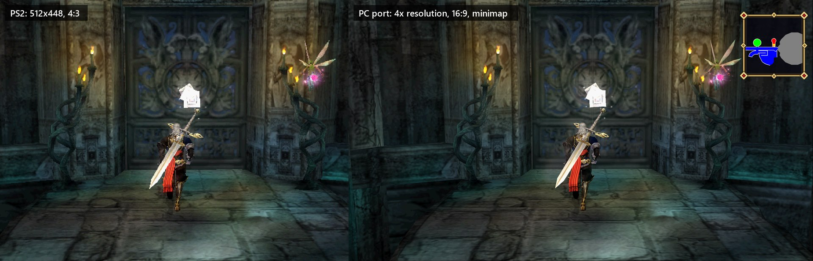
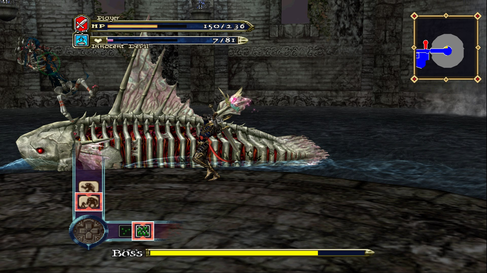
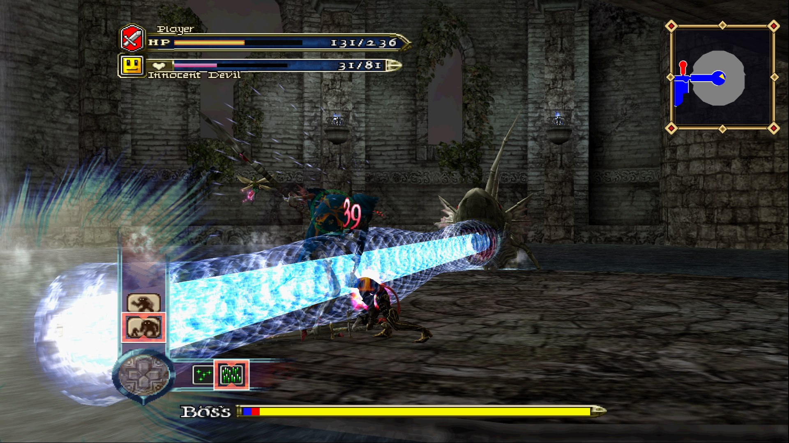
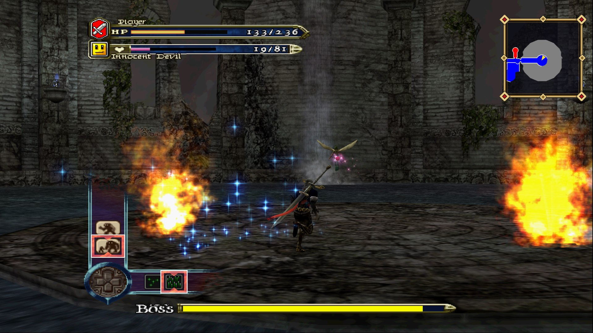
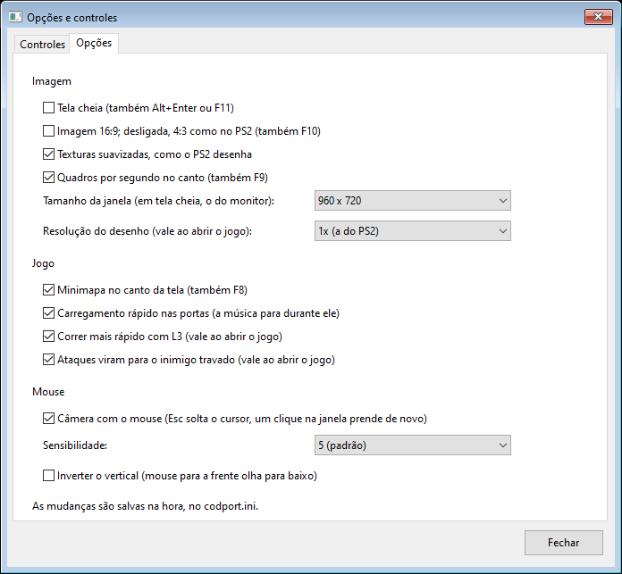

# Castlevania: Curse of Darkness - Native PC Port

**English** | [Português](#português)

An unofficial native Windows port of **Castlevania: Curse of Darkness** (PlayStation 2), built by static recompilation: the game's MIPS code is translated to C++ and compiled for x64, and what the PS2 does in hardware (the GS, the VU1, DMA, the IPU, the IOP, the SPU2, the DVD drive and the controller) is rewritten as PC code. It is not a general emulator; it runs this one game.

This is a personal, non-commercial fan project. It is not affiliated with or endorsed by Konami or Sony.

The port is made with the help of AI (Anthropic's Claude). Every change is tested before it is released: played in the game itself, and checked by replaying recorded play sessions and comparing their frames, which must stay identical wherever the change is not meant to alter the picture.

> [!IMPORTANT]
> **You need your own copy of the game.** This repository contains no game files: no disc image, no executable, no graphics, sound or movies, and no code generated from the game (only the screenshots below, of the port running). Everything is read from your own disc image, on your own computer, when you build and play.

## Screenshots

| | |
|---|---|
|  |  |
|  |  |

## What This Port Adds

- **Higher internal resolution** - the game is drawn at 2x, 3x or 4x the PS2's resolution, including effects that reuse what was drawn (glow, shadows), which stay sharp too.
- **Widescreen** - 16:9 shows more of the scene at the sides instead of stretching it; movies fill the screen and the HUD keeps its proportions. 4:3 is still available (**F10**).
- **Texture filtering** - surfaces are smoothed the way the PS2 itself draws them, through a cache of decoded textures sampled by the graphics card, at no cost in frame rate.
- **Minimap** - a map of the current area in the top right corner, taken from the game's own map screen, with a frame in the game's style. It only shows during play, never in menus or cutscenes (**F8**).
- **Sprint** - pressing **L3** while running makes Hector run faster, with its own pose: the torso leans forward, the strides lengthen and the arms swing wider.
- **Attacks turn to the target** - with an enemy locked on, attacks turn toward it.
- **Fast loading** - doors and Loading screens no longer wait for real time. The music pauses during them.
- **Settings menu** - **F1** opens a window with every action of the game to remap to a key or controller button, and all of the options above, each of which can be turned off. It is in English or Portuguese, chosen in the window itself (by default, the language of Windows).
- **Any screen size** - full screen at the monitor's own resolution, or a window sized for 1080p, 1440p, 4K or ultrawide screens, the picture kept in proportion with black bars.
- **Keyboard and Xbox controller** - XInput controllers work out of the box, and an optional frame counter shows performance (**F9**).
- **Interpolation (optional)** - on screens of 100 Hz or more, a picture is made for every refresh of the screen between the game's own, from the motion between them, so the game shows at 120, 144 or 240 frames per second. It is off by default (**F1**): it shows the game about one frame later, and fast-changing moments (explosions, scene cuts) can show small flaws.
- **Keyboard and mouse** - W/A/S/D move Hector, the mouse turns the camera directly (no lag, its sensitivity and an inverted vertical axis in **F1**), and its left and right buttons attack. A click in the window holds the cursor there; **Esc** lets it go.

## Required Game Version

Only the European release is supported. With another version, `recompile.bat` stops with an error.

| | Europe |
|---|---|
| Serial | `SLES-53755` |
| Disc | *Castlevania - Curse of Darkness (Europe) (En,Fr,De,Es,It)* |
| Executable | `SLES_537.55` |
| Executable SHA-1 | `5CFA9A001F94B654D809A8BF6997E0D890B463B1` |

Make an ISO image of your disc with any disc imaging tool. The image is only ever read, never changed.

## Requirements

### To Play

- Windows 10 or 11, 64-bit; or Linux and the Steam Deck through Proton (see [Linux and Steam Deck](#linux-and-steam-deck-untested), untested).
- Any 64-bit processor from 2008 on (with SSE4.1); AVX2 is not needed.
- A Direct3D 11 graphics card that supports rasterizer ordered views and double precision in shaders (developed on a GeForce GTX 1060). Without them the game draws on the processor, much more slowly.

### To Build

- Visual Studio 2022 or newer (the free Build Tools are enough) with the **Desktop development with C++** workload, which includes CMake and Ninja.
- Git, to clone the repository.
- A few GB of free disk space for the generated code and the build.

## Building

### 1. Install the Tools

Install Visual Studio or the Visual Studio Build Tools with **Desktop development with C++**.

### 2. Get the Port

Download the latest release from the **Releases** page and extract it. It comes with the port already built (`build\codport.exe`), which holds nothing of the game. Cloning the repository works too; then the setup builds the port first, which takes a couple of minutes more.

### 3. Run the Setup

Run `Setup.exe` (`Setup.bat` in a clone of the repository). It checks the build tools (and can install the free Visual Studio Build Tools for you), asks for the image of your disc and checks that it is the right game, then builds the game from it in two parts:

- **What the game runs from its start** - the code for the boot, the menus and nearly all of the time in play (picked by profiling recorded sessions), translated from your disc and compiled into `codport_game.dll` in about half a minute (15 seconds on the six performance cores of a Core i5-14400F). Then the game can be played, and a **Castlevania - Curse of Darkness** shortcut is on the desktop, with the bust of Hector that the PS2 showed for the game's saves (drawn from your disc as well).
- **Everything else** - the VU1 micro programs, the rest of what the game runs and the functions it seldom runs, compiled into `codport_game_vu.dll`, `codport_game_hot.dll` and `codport_game_cold.dll` in the background, at a low priority, for a few more minutes, even if the setup window is closed. Until each part is there its code runs on the interpreter, more slowly, and a game already open starts using it as soon as it is built.

Both parts are compiled with full optimization, and the same code results as building it all at once. From then on the shortcut, or `build\codport.exe`, just opens the game. It opens no console window.

### Building by Hand

1. Put your ISO in the repository folder (or in any folder above it), or let the game ask for it the first time it starts; the path is kept in `codport.ini`.
2. Run `build.bat`. This builds the port alone; it already runs the game, but by interpreting its MIPS code, slowly.
3. Run `recompile.bat`. It reads the game's executable from your ISO, translates the functions listed in `tools/recomp/functions.txt` to C++ (in `recomp/gen`, the ones listed in `tools/recomp/hot-functions.txt` apart from the others), compiles the VU1 micro programs listed in `tools/recomp/vu-blocks.idx` (in `recomp/vu`), and builds the four parts of the game's code from them (`codport_game.dll`, `codport_game_vu.dll`, `codport_game_hot.dll`, `codport_game_cold.dll`; what goes first is listed in `tools/recomp/boot-functions.txt`). It writes about 100 MB of code, which must not be shared.
4. Run `build\codport.exe`. Started from a terminal, its messages show there.

### Linux and Steam Deck (untested)

The port is a Windows program, and on Linux it runs through Proton, as Steam runs Windows games. This has not been tried on a Steam Deck yet: it is written from how Proton, DXVK and the Deck's graphics driver work, and its compile step was tested on Windows with the same tools. Reports in [Issues](https://github.com/fasipe/Castlevania-COD-QOL/issues) are welcome, working or not.

`Setup.exe` and `Texture Pack Mod.exe` need Windows' PowerShell and Visual Studio, which Proton does not have, so on Linux the setup is `Setup-Linux.sh`:

1. On the Deck, switch to **Desktop Mode**. Steam must have a Proton installed (any Windows game played once installs one; or install **Proton Experimental** from the library). About 5 GB must be free.
2. Extract the release zip whole, for example into `~/Games/Castlevania-COD`, and put your ISO anywhere.
3. Open a terminal there (Konsole: right click in the folder, **Open Terminal Here**) and run `sh Setup-Linux.sh`. It asks for the ISO (or give its path after the command) and then:
   - downloads LLVM's `clang-cl` and `lld-link` once (about 2 GB, of which some 300 MB are kept), which build Windows programs natively on Linux;
   - runs `xwin`, which downloads Microsoft's C++ runtime and Windows SDK from Microsoft: it shows Microsoft's license and asks you to type `yes`;
   - translates the game from your disc with `build/codport.exe`, run through Proton;
   - compiles the four parts of the game's code, as `Setup.exe` does, using every core (several minutes on the Deck). It can be stopped and run again: it goes on where it was.
4. In Steam: **Games > Add a Non-Steam Game to My Library**, browse to `build/codport.exe` and add it. In its **Properties > Compatibility**, tick **Force the use of a specific Steam Play compatibility tool** and pick **Proton Experimental** (or Proton 9 or newer).
5. Play it from Steam, also in Game Mode. The Deck's controls reach the game as an Xbox controller.

Notes for the Deck: the graphics card path needs rasterizer ordered views, which Proton (DXVK) offers on the Deck's driver from Mesa 23.2 on (current SteamOS has it); without them the game draws on the processor, too slowly to play. The shaders come compiled in `build/shaders.bin`, so Proton's HLSL compiler is not needed. 1x or 2x resolution suits the Deck's screen; on the 90 Hz screen of the OLED model the interpolation can be turned on in **F1** (Steam + X opens the keyboard). Texture packs are installed by hand: their PNG files go in `textures/replace`.

## Controls

### Keyboard and Mouse

| Action | Key |
|---|---|
| Move | W / A / S / D |
| Camera | Mouse, or I / J / K / L |
| Attack | Left mouse button |
| Final attack / Steal / Examine | Right mouse button |
| Jump / Confirm | Space |
| Innocent Devil ability / Back | E |
| Guard | F |
| Lock on | Middle mouse button (wheel click) |
| Change target | 1 |
| Reset camera | Q |
| Sprint | Shift |
| Map | Tab |
| Menu | Enter |
| Innocent Devil AI | Arrow keys |

### Controller

**A** jump, **X** attack, **B** final attack, **Y** Innocent Devil ability, **RB** guard, **RT** lock on, **LT** change target, **LB** reset camera, **LS** (left stick click) sprint, **Back** map, **Start** menu.

### Shortcuts

| Key | What it does |
|---|---|
| **F1** | Settings and controls |
| **Esc** | Let the mouse go (a click in the window holds it again) |
| **Alt+Enter** or **F11** | Full screen |
| **F10** | 4:3 or 16:9 |
| **F9** | Frame counter |
| **F8** | Minimap |

## Settings

Everything in the **F1** window is saved at once in `codport.ini`, next to the `memcard` folder, which is created the first time the game starts and can also be edited by hand. Every option changes at once, the internal resolution included, with no need to start the game again; **Save** closes the window.

Saves go to the `memcard` folder. Each session is also recorded in `build/recordings` (inputs, clock and a copy of the memory card) and plays back exactly with `codport --replay <file>`; this is meant for testing, and the folder can be deleted.

## Texture Packs

The port can use new textures in place of the game's, at any resolution.

- **To make a pack:** set `salvar_texturas=1` in `codport.ini` and play. Each texture the game shows is saved once in `textures\dump`, as a PNG named by a hash of its contents (alpha is saved so that 255 is opaque). Edit or upscale them, keeping the names.
- **To use a pack:** open `Texture Pack Mod.exe` (next to `Setup.exe`) and choose the pack's `.zip` or folder, or drag it onto the window. Before installing, it says how many textures the pack replaces and which of them other packs installed already replace; packs can be removed there too. Where two packs replace the same texture, the one installed last is used. By hand, the PNG files go in `textures\replace` (subfolders are fine). With `pacote_texturas=1`, the default, the port loads them when the game starts and draws them in place of the game's.

Only textures the game loads from the disc can be replaced, not pictures it draws itself (glows, the minimap), and only those it draws smoothed, which is nearly all of the 3D world. Packs made from your own disc are yours; do not share the dumped textures as they are, since they are the game's.

## Port Notes

- `src/ee` - the PS2's main processor (R5900): a reference interpreter, memory, a reimplementation of the EE kernel, and the VU0 and VU1.
- `src/recomp` - the MIPS to C++ recompiler, the compiler for the VU1 micro programs, and the loader of the game's code (`codport_game*.dll`, built on the player's computer, also while the game runs).
- `src/gs` - DMA, VIF, GIF and the GS: drawing with Direct3D 11 (`gpu.cpp`, `gpu_shaders.h`), plus a software rasterizer for comparison (`--software`).
- `src/ipu` - the MPEG-2 decoder for the movies.
- `src/iop` - the I/O processor's services (disc, memory card, controller) and an emulated IOP that runs the game's own sound modules on a model of the SPU2.
- `src/game` - the changes to the game (widescreen, minimap, sprint, attack turn, loading), as hooks on functions of the recompiled code.
- `src/host` - the window, audio, controllers and settings.
- `tools/ghidra` - scripts to analyse the executable with Ghidra; `tools/recomp` - the lists of what the recompilers translate, as addresses only.

`codport --help` lists the command line options, which are mostly for testing.

## Known Issues

- Only the European version (`SLES-53755`) works.
- Windows only, apart from Linux and the Steam Deck through Proton, untested.
- Fast loading skips the sound of those moments: the music pauses and the door's sound is not heard. It can be turned off in **F1**.
- During the sprint the feet can slide slightly on the ground, since the strides are longer than the game's animation.
- Ultrawide screens show the 16:9 picture with black bars at the sides.

## Ideas and Problems

The [Issues](https://github.com/fasipe/Castlevania-COD-QOL/issues) page is open to any idea of something to add or improve, not only to problems: a feature you miss, an option, a quality of life change. For a problem, say what happened, where in the game, and your CPU and graphics card. Security problems go privately through the **Security** tab instead (see `SECURITY.md`).

## Legal

Castlevania and Castlevania: Curse of Darkness are trademarks of Konami. This project is not affiliated with Konami or Sony. Do not share disc images, the game's executable, files extracted from it, or the code generated from it (`recomp`, `codport_game*.dll`).

## License

The port's own code is under the MIT license (see `LICENSE`). It covers none of the game: the game and everything generated from it remain Konami's.

## Credits

- The widescreen patch for this game made for PCSX2 by nemesis2000, applied here as hooks on the recompiled code (`src/game/widescreen.cpp`).

---

# Português

[English](#castlevania-curse-of-darkness---native-pc-port) | **Português**

Um port nativo e não oficial para Windows de **Castlevania: Curse of Darkness** (PlayStation 2), feito por recompilação estática: o código MIPS do jogo é traduzido para C++ e compilado para x64, e o que o PS2 faz em hardware (o GS, a VU1, o DMA, a IPU, o IOP, o SPU2, o leitor de DVD e o controle) é reescrito como código de PC. Não é um emulador genérico; ele roda só este jogo.

Este é um projeto de fã, pessoal e sem fins comerciais. Não tem relação nem aprovação da Konami ou da Sony.

O port é feito com a ajuda de IA (o Claude, da Anthropic). Cada alteração é testada antes de ser lançada: jogada no próprio jogo e conferida reproduzindo sessões de jogo gravadas e comparando os quadros, que precisam continuar idênticos onde a alteração não deve mudar a imagem.

> [!IMPORTANT]
> **Você precisa da sua própria cópia do jogo.** Este repositório não contém nenhum arquivo do jogo: nem imagem de disco, nem executável, nem gráficos, sons ou vídeos, nem código gerado a partir do jogo (só as capturas abaixo, do port rodando). Tudo é lido da imagem do seu próprio disco, no seu computador, na hora de compilar e de jogar.

## Capturas de Tela

| | |
|---|---|
|  |  |
|  |  |

## O Que Este Port Acrescenta

- **Resolução interna maior** - o jogo é desenhado em 2x, 3x ou 4x a resolução do PS2, inclusive os efeitos que reaproveitam o que foi desenhado (brilho, sombras), que também ficam nítidos.
- **Widescreen** - em 16:9 a câmera mostra mais dos lados em vez de esticar a imagem; os vídeos preenchem a tela e a HUD mantém a proporção. O 4:3 continua disponível (**F10**).
- **Filtro de textura** - as superfícies são suavizadas como o próprio PS2 desenha, por um cache de texturas decodificadas lidas pela placa de vídeo, sem custo de quadros por segundo.
- **Minimapa** - um mapa da área atual no canto superior direito, tirado da própria tela de mapa do jogo, com moldura no estilo do jogo. Aparece só durante o jogo, nunca em menus ou cenas (**F8**).
- **Sprint** - apertar **L3** enquanto corre faz o Hector correr mais rápido, com pose própria: o tronco inclina, as passadas ficam mais longas e os braços balançam mais.
- **Ataques no alvo** - com um inimigo travado, os ataques viram na direção dele.
- **Carregamento rápido** - portas e telas de Loading não esperam mais o tempo real. A música pausa durante eles.
- **Menu de configurações** - o **F1** abre uma janela com todas as ações do jogo para trocar a tecla ou o botão do controle, e todas as opções acima, cada uma podendo ser desligada. Ela fica em português ou inglês, escolhido na própria janela (por padrão, o idioma do Windows).
- **Qualquer tamanho de tela** - tela cheia na resolução do próprio monitor, ou janela em tamanhos para telas 1080p, 1440p, 4K ou ultrawide, com a imagem mantida na proporção por barras pretas.
- **Teclado e controle Xbox** - controles XInput funcionam direto, e um contador de quadros opcional mostra o desempenho (**F9**).
- **Interpolação (opcional)** - em telas de 100 Hz ou mais, uma imagem é feita para cada atualização da tela entre as do jogo, a partir do movimento entre elas, e o jogo aparece a 120, 144 ou 240 quadros por segundo. Vem desligada (**F1**): mostra o jogo cerca de um quadro depois, e momentos que mudam muito rápido (explosões, cortes de cena) podem ter pequenas falhas.
- **Teclado e mouse** - W/A/S/D movem o Hector, o mouse gira a câmera direto (sem atraso, com sensibilidade e vertical invertido no **F1**) e seus botões esquerdo e direito atacam. Um clique na janela prende o cursor nela; o **Esc** solta.

## Versão Necessária do Jogo

Só a versão europeia é suportada. Com outra versão, o `recompile.bat` para com um erro.

| | Europa |
|---|---|
| Serial | `SLES-53755` |
| Disco | *Castlevania - Curse of Darkness (Europe) (En,Fr,De,Es,It)* |
| Executável | `SLES_537.55` |
| SHA-1 do executável | `5CFA9A001F94B654D809A8BF6997E0D890B463B1` |

Faça uma imagem ISO do seu disco com qualquer programa de imagem de disco. A imagem só é lida, nunca alterada.

## Requisitos

### Para Jogar

- Windows 10 ou 11, 64 bits; ou Linux e Steam Deck pelo Proton (veja [Linux e Steam Deck](#linux-e-steam-deck-não-testado), não testado).
- Qualquer processador de 64 bits de 2008 em diante (com SSE4.1); AVX2 não é necessário.
- Placa de vídeo com Direct3D 11 e suporte a *rasterizer ordered views* e a precisão dupla nos shaders (desenvolvido numa GeForce GTX 1060). Sem isso o jogo desenha no processador, bem mais devagar.

### Para Compilar

- Visual Studio 2022 ou mais novo (o Build Tools gratuito basta) com a carga de trabalho **Desenvolvimento para desktop com C++**, que já traz o CMake e o Ninja.
- Git, para clonar o repositório.
- Alguns GB livres em disco para o código gerado e a compilação.

## Compilação

### 1. Instale as Ferramentas

Instale o Visual Studio ou o Visual Studio Build Tools com **Desenvolvimento para desktop com C++**.

### 2. Baixe o Port

Baixe a versão mais recente na página **Releases** e extraia. Ela já vem com o port compilado (`build\codport.exe`), que não contém nada do jogo. Clonar o repositório também funciona; aí o Setup compila o port antes, o que leva alguns minutos a mais.

### 3. Rode o Setup

Rode o `Setup.exe` (`Setup.bat` num clone do repositório). Ele confere as ferramentas de compilação (e pode instalar o Visual Studio Build Tools gratuito para você), pede a imagem do seu disco e confere se é o jogo certo, e então gera o jogo a partir dela em duas partes:

- **O que o jogo roda desde o início** - o código do boot, dos menus e de quase todo o tempo de jogo (escolhido pelo perfil de sessões gravadas), traduzido do seu disco e compilado em `codport_game.dll` em cerca de meio minuto (15 segundos nos seis núcleos de desempenho de um Core i5-14400F). Daí já dá para jogar, e há um atalho **Castlevania - Curse of Darkness** na área de trabalho, com o busto do Hector que o PS2 mostrava nos saves do jogo (também tirado do seu disco).
- **O resto** - os microprogramas da VU1, o resto do que o jogo roda e as funções que ele raramente usa, compilados em `codport_game_vu.dll`, `codport_game_hot.dll` e `codport_game_cold.dll` em segundo plano, com prioridade baixa, por mais alguns minutos, mesmo que a janela do Setup seja fechada. Até cada parte ficar pronta, o código dela roda no interpretador, mais devagar, e um jogo já aberto passa a usá-la assim que ela é gerada.

As duas partes são compiladas com otimização total, e o resultado é o mesmo código de compilar tudo de uma vez. Daí em diante o atalho, ou `build\codport.exe`, só abre o jogo. Ele não abre janela de console.

### Compilação à Mão

1. Coloque a sua ISO na pasta do repositório (ou em qualquer pasta acima dela), ou deixe o jogo pedir por ela na primeira vez que abrir; o caminho fica guardado no `codport.ini`.
2. Rode `build.bat`. Isso compila o port sozinho; ele já roda o jogo, mas interpretando o código MIPS, devagar.
3. Rode `recompile.bat`. Ele lê o executável do jogo na sua ISO, traduz para C++ as funções listadas em `tools/recomp/functions.txt` (em `recomp/gen`, as listadas em `tools/recomp/hot-functions.txt` separadas das outras), compila os microprogramas da VU1 listados em `tools/recomp/vu-blocks.idx` (em `recomp/vu`) e gera com eles as quatro partes do código do jogo (`codport_game.dll`, `codport_game_vu.dll`, `codport_game_hot.dll`, `codport_game_cold.dll`; o que vai primeiro está listado em `tools/recomp/boot-functions.txt`). Ele gera cerca de 100 MB de código, que não deve ser compartilhado.
4. Rode `build\codport.exe`. Rodado de um terminal, as mensagens aparecem nele.

### Linux e Steam Deck (não testado)

O port é um programa de Windows, e no Linux ele roda pelo Proton, como a Steam roda jogos de Windows. Isso ainda não foi experimentado num Steam Deck: foi feito a partir de como o Proton, o DXVK e o driver de vídeo do Deck funcionam, e a parte da compilação foi testada no Windows com as mesmas ferramentas. Relatos nas [Issues](https://github.com/fasipe/Castlevania-COD-QOL/issues) são bem-vindos, funcionando ou não.

O `Setup.exe` e o `Texture Pack Mod.exe` precisam do PowerShell e do Visual Studio do Windows, que o Proton não tem, então no Linux o instalador é o `Setup-Linux.sh`:

1. No Deck, mude para o **Modo Desktop**. A Steam precisa ter um Proton instalado (qualquer jogo de Windows jogado uma vez instala um; ou instale o **Proton Experimental** pela biblioteca). São necessários uns 5 GB livres.
2. Extraia o zip da release inteiro, por exemplo em `~/Games/Castlevania-COD`, e deixe sua ISO em qualquer lugar.
3. Abra um terminal ali (Konsole: botão direito na pasta, **Abrir terminal aqui**) e rode `sh Setup-Linux.sh`. Ele pede a ISO (ou passe o caminho depois do comando) e então:
   - baixa uma vez o `clang-cl` e o `lld-link` do LLVM (uns 2 GB, dos quais ficam uns 300 MB), que geram programas de Windows direto no Linux;
   - roda o `xwin`, que baixa da Microsoft o runtime de C++ e o SDK do Windows: ele mostra a licença da Microsoft e pede que você digite `yes`;
   - traduz o jogo do seu disco com o `build/codport.exe`, rodando pelo Proton;
   - compila as quatro partes do código do jogo, como o `Setup.exe` faz, usando todos os núcleos (alguns minutos no Deck). Pode ser interrompido e rodado de novo: ele continua de onde parou.
4. Na Steam: **Jogos > Adicionar um jogo não Steam à biblioteca**, procure o `build/codport.exe` e adicione. Em **Propriedades > Compatibilidade**, marque **Forçar o uso de uma ferramenta de compatibilidade específica do Steam Play** e escolha **Proton Experimental** (ou Proton 9 ou mais novo).
5. Jogue pela Steam, também no Modo de Jogo. Os controles do Deck chegam ao jogo como um controle de Xbox.

Notas para o Deck: o desenho na placa de vídeo precisa de *rasterizer ordered views*, que o Proton (DXVK) oferece no driver do Deck a partir do Mesa 23.2 (o SteamOS atual já tem); sem elas o jogo desenha no processador, devagar demais para jogar. Os shaders já vêm compilados no `build/shaders.bin`, então o compilador de HLSL do Proton não é necessário. Resolução 1x ou 2x combina com a tela do Deck; na tela de 90 Hz do modelo OLED a interpolação pode ser ligada no **F1** (Steam + X abre o teclado). Pacotes de texturas são instalados à mão: os PNG vão em `textures/replace`.

## Controles

### Teclado e Mouse

| Ação | Tecla |
|---|---|
| Andar | W / A / S / D |
| Câmera | Mouse, ou I / J / K / L |
| Atacar | Botão esquerdo do mouse |
| Golpe final / Roubar / Examinar | Botão direito do mouse |
| Pular / Confirmar | Espaço |
| Habilidade do Innocent Devil / Voltar | E |
| Defender | F |
| Travar no alvo | Botão do meio do mouse (clique na roda) |
| Trocar de alvo | 1 |
| Centralizar a câmera | Q |
| Sprint | Shift |
| Mapa | Tab |
| Menu | Enter |
| IA do Innocent Devil | Setas |

### Controle

**A** pular, **X** atacar, **B** golpe final, **Y** habilidade do Innocent Devil, **RB** defender, **RT** travar no alvo, **LT** trocar de alvo, **LB** centralizar a câmera, **LS** (apertar o analógico esquerdo) sprint, **Back** mapa, **Start** menu.

### Atalhos

| Tecla | O que faz |
|---|---|
| **F1** | Configurações e controles |
| **Esc** | Solta o mouse (um clique na janela prende de novo) |
| **Alt+Enter** ou **F11** | Tela cheia |
| **F10** | 4:3 ou 16:9 |
| **F9** | Contador de quadros |
| **F8** | Minimapa |

## Configurações

Tudo na janela do **F1** é salvo na hora em `codport.ini`, ao lado da pasta `memcard`; o arquivo é criado na primeira vez que o jogo abre e também pode ser editado à mão. Todas as opções mudam na hora, inclusive a resolução interna, sem precisar abrir o jogo de novo; o **Salvar** fecha a janela.

Os saves ficam na pasta `memcard`. Cada sessão também é gravada em `build/recordings` (entradas, relógio e uma cópia do cartão de memória) e reproduz exatamente com `codport --replay <arquivo>`; isso serve para testes, e a pasta pode ser apagada.

## Pacotes de Texturas

O port pode usar texturas novas no lugar das do jogo, em qualquer resolução.

- **Para fazer um pacote:** ponha `salvar_texturas=1` no `codport.ini` e jogue. Cada textura que o jogo mostra é salva uma vez em `textures\dump`, como PNG com o nome de um hash do conteúdo (a transparência é salva de modo que 255 seja opaco). Edite ou aumente as imagens, mantendo os nomes.
- **Para usar um pacote:** abra o `Texture Pack Mod.exe` (ao lado do `Setup.exe`) e escolha o `.zip` ou a pasta do pacote, ou arraste para a janela. Antes de instalar, ele diz quantas texturas o pacote troca e quais delas outros pacotes já instalados trocam; os pacotes também podem ser removidos ali. Quando dois pacotes trocam a mesma textura, vale o instalado por último. À mão, os PNG vão em `textures\replace` (subpastas valem). Com `pacote_texturas=1`, o padrão, o port carrega tudo ao abrir o jogo e desenha no lugar das do jogo.

Só dá para trocar texturas que o jogo carrega do disco, não imagens que ele mesmo desenha (brilhos, o minimapa), e só as que ele desenha suavizadas, que são quase todo o mundo 3D. Pacotes feitos a partir do seu disco são seus; não compartilhe as texturas salvas como estão, já que são do jogo.

## Notas do Port

- `src/ee` - o processador principal do PS2 (R5900): um interpretador de referência, a memória, uma reimplementação do kernel do EE, e as VU0 e VU1.
- `src/recomp` - o recompilador de MIPS para C++, o compilador dos microprogramas da VU1, e o carregador do código do jogo (`codport_game*.dll`, gerados no computador de quem joga, também com o jogo aberto).
- `src/gs` - DMA, VIF, GIF e o GS: desenho em Direct3D 11 (`gpu.cpp`, `gpu_shaders.h`), e um rasterizador em software para comparação (`--software`).
- `src/ipu` - o decodificador de MPEG-2 dos vídeos.
- `src/iop` - os serviços do processador de entrada e saída (disco, cartão de memória, controle) e um IOP emulado que roda os módulos de som do próprio jogo sobre um modelo do SPU2.
- `src/game` - as mudanças no jogo (widescreen, minimapa, sprint, ataques no alvo, carregamento), como ganchos em funções do código recompilado.
- `src/host` - a janela, o áudio, os controles e as configurações.
- `tools/ghidra` - scripts para analisar o executável com o Ghidra; `tools/recomp` - as listas do que os recompiladores traduzem, só com endereços.

`codport --help` lista as opções de linha de comando, usadas sobretudo para testes.

## Problemas Conhecidos

- Só a versão europeia (`SLES-53755`) funciona.
- Só Windows, fora Linux e Steam Deck pelo Proton, não testados.
- O carregamento rápido pula o som desses momentos: a música pausa e o som da porta não toca. Ele pode ser desligado no **F1**.
- Durante o sprint os pés podem deslizar um pouco no chão, porque as passadas são mais longas que as da animação do jogo.
- Telas ultrawide mostram a imagem 16:9 com barras pretas nas laterais.

## Ideias e Problemas

A página de [Issues](https://github.com/fasipe/Castlevania-COD-QOL/issues) está aberta para qualquer ideia de algo a acrescentar ou melhorar, não só para problemas: um recurso que faz falta, uma opção, uma melhoria de qualidade de vida. Para um problema, diga o que aconteceu, em que parte do jogo, e o seu processador e placa de vídeo. Problemas de segurança vão em particular pela aba **Security** (veja o `SECURITY.md`).

## Aviso Legal

Castlevania e Castlevania: Curse of Darkness são marcas registradas da Konami. Este projeto não tem relação com a Konami nem com a Sony. Não compartilhe imagens de disco, o executável do jogo, arquivos extraídos dele nem o código gerado a partir dele (`recomp`, `codport_game*.dll`).

## Licença

O código do próprio port está sob a licença MIT (veja `LICENSE`). Ela não cobre nada do jogo: o jogo e tudo que é gerado a partir dele continuam sendo da Konami.

## Créditos

- O patch de widescreen deste jogo feito para o PCSX2 por nemesis2000, aplicado aqui como ganchos no código recompilado (`src/game/widescreen.cpp`).
